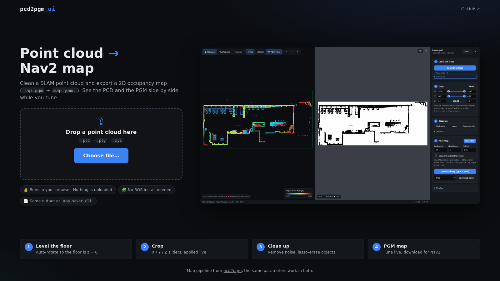
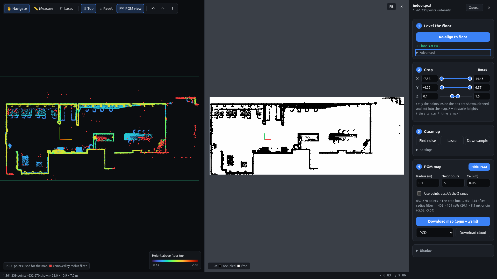
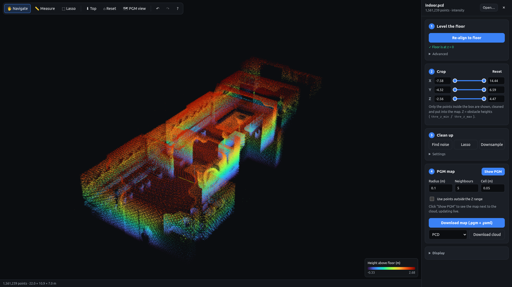
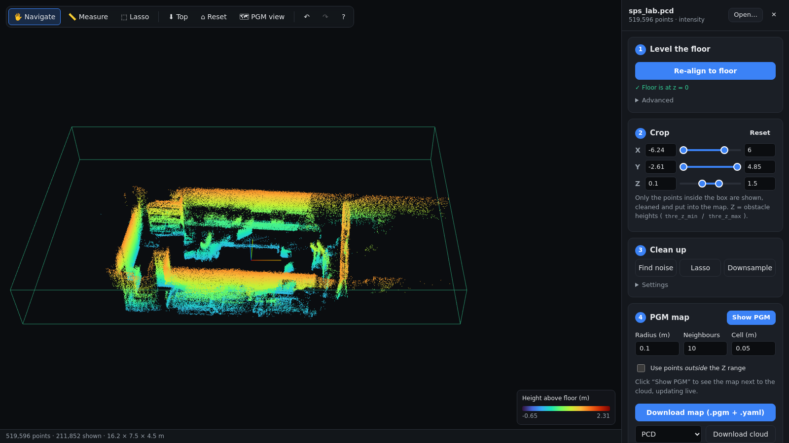

# pcd2pgm_ui

A browser tool that turns a SLAM point cloud into a 2D occupancy map (PGM) for ROS 2 Nav2. The PCD and the PGM are shown side by side, and the map updates live while you tune. No ROS install needed: everything runs locally in the browser and nothing is uploaded.



## Installation

1. Clone the repository:
   ```bash
   git clone https://github.com/alitekes1/pcd2pgm_ui.git
   ```
2. Navigate to the project directory:
   ```bash
   cd pcd2pgm_ui
   ```
3. Serve the folder with any static web server, for example:
   ```bash
   python3 -m http.server 8000
   ```
   Then open `http://localhost:8000`. Three.js is loaded from a CDN, so the first load needs internet access. Local files get a per-load `?v=` query, so after an update a normal reload is enough.

## How it works



Open a `.pcd`, `.ply` or `.xyz` file (button or drag & drop). PCD can be ascii, binary or binary_compressed. Then follow the four steps in the side panel:

| Step | What it does |
| --- | --- |
| **1. Level the floor** | RANSAC finds the floor among the lowest points and rotates the cloud so the floor lies at z = 0. *Advanced* lets you change the floor tolerance and max tilt, or apply pcd2pgm's `odom_to_lidar_odom` `[x, y, z, roll, pitch, yaw]` by hand (the cloud is moved by its inverse). |
| **2. Crop** | One two-thumb slider per X / Y / Z axis, applied **live** in the 3D view. Only the points inside the box are shown, cleaned and put into the map. Z is pcd2pgm's obstacle height range. |
| **3. Clean up** | *Find noise* (statistical outlier removal; the points it would remove turn red, then you choose *Remove* or *Cancel*), *Lasso* to erase people, cars and other objects, and *Downsample* (voxel grid). |
| **4. PGM map** | *Show PGM* opens the side-by-side view. Then download `map.pgm` + `map.yaml`, or the cleaned cloud (PCD / PLY). |



### Crop



The crop box is shown while something is cut away. Z starts at the full range; when the PGM view is opened for the first time it is set to pcd2pgm's default of 0.1 … 1.5 m above the floor. You can also right-click a point to crop X/Y around it or to use its height as Z min / Z max.

### PGM view

The PCD pane switches to a top view that stays aligned with the PGM: zooming or panning one pane moves the other, and the cursor is shown in both. Changing any parameter rebuilds the map automatically. Only the radius filter runs in a Web Worker, and its result is cached, so changing just the cell size is instant.

The pipeline is the one from [pcd2pgm](https://github.com/LihanChen2004/pcd2pgm), and each setting maps to a key in its config file:

| UI | pcd2pgm parameter |
| --- | --- |
| Crop Z min / max | `thre_z_min` / `thre_z_max` (pass-through on z) |
| Use points outside the Z range | `flag_pass_through` |
| Radius / Neighbours | `thre_radius` / `thres_point_count` (keep a point if at least *n* other points lie within *r*) |
| Cell | `map_resolution` |
| Advanced → manual transform | `odom_to_lidar_odom` |

Points removed by the radius filter are drawn in red in the PCD pane; they are not in the map. Every remaining point marks its cell as occupied, and all other cells inside the bounding box are free. The map origin is the minimum x/y of those points. One deliberate difference from pcd2pgm: the grid is sized with `floor + 1` instead of `ceil`, so points lying exactly on the max edge are kept.

### Export

- **Map**: `map.pgm` + `map.yaml`, the same files `map_saver_cli` writes (trinary, occupied = 0, free = 254). The map is in the current frame, i.e. after floor alignment or the manual transform.
- **Cloud**: the points inside the crop box, as binary PCD or PLY, in the original file coordinates. RGB and intensity are kept.

## Usage

Open a file, then follow the numbered steps in the side panel. Tools are also on the toolbar (top-left) and in the right-click menu.

| Input | Action |
| --- | --- |
| Left drag | Orbit |
| Middle drag / Shift + left drag / arrow keys | Pan |
| Wheel | Zoom toward the cursor |
| Double-click a point / empty space | Focus it / reset view |
| Right-click | Menu: focus, set Z min / Z max to this height, crop X/Y around a point, reset crop |
| `M` / `L` / `T` / `P` | Measure / Lasso / Top view / PGM side-by-side view |
| PGM pane: wheel / drag / double-click | Zoom / pan / fit |
| `Del` / `Enter` / `Esc` | Lasso: delete / keep selection / cancel |
| `Ctrl+Z` / `Ctrl+Shift+Z` | Undo / Redo (10 steps) |
| `?` | Help |


## Acknowledgements

This project is built upon and extends the work from [LihanChen2004/pcd2pgm](https://github.com/LihanChen2004/pcd2pgm). Additionally, this project has benefited from the assistance of GPT models for various aspects of development and documentation.

